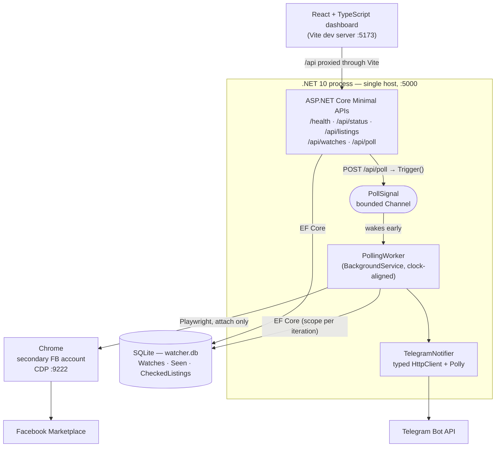
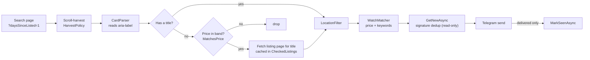

# Marketplace Watcher

A **.NET 10 (C#)** service that watches **Facebook Marketplace**, filters listings against
configurable searches, dedupes them, and sends **Telegram** alerts for genuinely new items.

A .NET port of an earlier Java/Spring project (*House Hunt 2026*).

> **Status:** backend and React dashboard both work end-to-end and run daily. Optional phases
> (Postgres/Aspire/Docker, local-LLM scoring) are not started — see [PROGRESS.md](PROGRESS.md).

## What it does

- **Dynamic watches** — created and stopped at runtime over the API (a subscription model), each
  with its own price range and include/exclude keyword filters. No restart needed.
- **Gentle scraping** — a background loop polls on a clock-aligned interval (default every 30
  minutes, on :00 and :30) by *attaching* to a Chrome session over CDP. It never launches a
  browser, never logs in, and never touches credentials. One page at a time, sequentially.
- **Card parsing** — reads each card's `aria-label`, which carries clean
  `{title}, NZ${price}, {location}, listing {id}` text. Harvests the virtualized feed by scrolling
  until two consecutive rounds yield nothing new.
- **Recency filter** — only scrapes listings posted in the last day (`daysSinceListed`).
- **Location filter** — Facebook pads sparse searches with nationwide results, so listings are
  filtered against a configured list of local place names.
- **Content-signature dedup** — a SHA-256 of normalized `title|price|location`, deliberately
  *excluding* the URL, so a relisted item doesn't alert twice.
- **Title recovery** — Facebook renders no title for roughly half of vehicle listings. Those get
  their real title read from the listing page, cached so each is fetched at most once.
- **At-least-once Telegram alerts** — a listing is only recorded as seen once its alert actually
  sent, so an outage delays alerts rather than losing them.

## Architecture

One .NET process hosts both the web API and the background worker. The React app is a separate
dev server that proxies to it.



**Why it looks like this**

- **One process, two roles.** The worker and the API share a DI container and one SQLite file, so
  the API can read what the worker wrote and wake it on demand. No message broker for a
  single-user tool.
- **`PollSignal` instead of polling a flag.** A bounded `Channel` (capacity 1, drop-on-full) lets
  `POST /api/poll` and watch creation wake the loop immediately; only the *fact* that something
  changed matters, not how many times.
- **Attach, never launch.** Playwright connects to a Chrome *you* started and reuses
  `Contexts[0]`. No credentials touch the app.
- **Scope per iteration.** `PollingWorker` is a singleton but `DbContext` is scoped, so each loop
  creates its own scope. Typed `HttpClient`s are transient and resolved the same way.

### What one poll does



Each stage is logged as a funnel line, so a listing that vanishes can be traced to the stage that
dropped it:

```
Watch Toyota Prius: 25 titleless in-budget listing(s), 10 page load(s), 10 title(s) recovered
Watch Toyota Prius funnel: 49 harvested (28 with no title) → 49 in-region → 15 passed filters → 9 not seen before
```

### Data model

| Table | Key | Holds |
|---|---|---|
| `Watches` | `Id` | Your searches. Soft-deleted via `IsActive` so history isn't orphaned |
| `Seen` | `Signature` | Listings already alerted on. SHA-256 of `title\|price\|location`, **excluding the URL**, so a relist doesn't re-alert |
| `CheckedListings` | `ListingId` | Titles recovered from listing pages — **or null**. Ensures each listing is fetched at most once, ever |

`Seen` and `CheckedListings` are deliberately separate: `Seen` is keyed on *content* and holds
only accepted listings; `CheckedListings` is keyed on *listing id* and must remember rejections
too.

### Design decisions

The non-obvious choices are written up as ADRs in [DECISIONS.md](DECISIONS.md):

| ADR | Decision |
|---|---|
| 001 | Telegram, not WhatsApp — business-initiated messaging is paid and template-only |
| 002 | At-least-once delivery — duplicates beat losses for an alerting tool |
| 003 | Verify scraper assumptions against a noise floor before believing them |
| 004 | Search radius is environmental — Facebook ignores URL params |
| 005 | Titleless cards are dropped (records a reversal made on real-world evidence) |
| 006 | Recover missing titles from the listing page, cached and capped |

## Prerequisites

- .NET 10 SDK
- Google Chrome
- A Telegram bot token (via [@BotFather](https://t.me/BotFather)) and a chat/channel id

## Run it

**1. Start the secondary-account Chrome** (a dedicated profile, logged in to the Facebook account
you want to watch with — never your primary):

```bash
"/Applications/Google Chrome.app/Contents/MacOS/Google Chrome" \
  --remote-debugging-port=9222 \
  --user-data-dir="$HOME/.fb-secondary-chrome"
```

Sanity check it's listening: `curl http://localhost:9222/json/version`

**2. Set your secrets** (stored outside the repo, never committed):

```bash
dotnet user-secrets set "Telegram:BotToken" "<token>" --project src/MarketplaceWatcher
dotnet user-secrets set "Telegram:ChatId"  "<chat-id>" --project src/MarketplaceWatcher
```

> `dotnet user-secrets` resolves the project from the current directory, so from the repo root you
> must pass `--project` — the root only has a `.slnx`, which carries no `UserSecretsId`.

**3. Run:**

```bash
dotnet run --project src/MarketplaceWatcher
```

**4. Add a watch:**

```bash
curl -X POST http://localhost:5000/api/watches \
  -H "Content-Type: application/json" \
  -d '{"name":"sofa","minPrice":0,"maxPrice":200,"excludeKeywords":["wanted","parts"]}'
```

The poll loop wakes immediately — no waiting for the interval.

## API

| Endpoint | Purpose |
|---|---|
| `GET /health` | Liveness — is the process up |
| `GET /api/status` | Is it *working* — last poll, failures, counts |
| `GET /api/watches` | List active watches |
| `POST /api/watches` | Create a watch (triggers an immediate poll) |
| `DELETE /api/watches/{id}` | Soft-disable a watch |
| `POST /api/poll` | Trigger an immediate poll |

## Configuration

`src/MarketplaceWatcher/appsettings.json`:

| Key | Meaning |
|---|---|
| `PollIntervalSeconds` | Poll gap, **aligned to the clock** from midnight. `1800` → :00/:30, `3600` → on the hour |
| `DaysSinceListed` | Only scrape listings this recent (default 1; null disables) |
| `AllowedLocations` | Place names a listing must match. **Empty disables the filter** |

### A note on `AllowedLocations`

Matching is case-insensitive **substring**, so `"Mangere"` also covers `"Mangere Bridge"`, and
`"Te Atatu"` covers both Peninsula and South. The shipped list covers suburbs within roughly 15km
of Auckland CBD.

It is **fail-closed**: a local suburb whose name isn't in the list gets dropped. Every poll logs
the distinct locations it rejected, so watch for `Dropped N out-of-region listing(s): ...` and add
anything you're missing.

⚠️ These names also exist in other NZ cities, so they may occasionally let a non-Auckland listing
through: **Avondale** (Christchurch), **Hillsborough** (Christchurch), **Northcote** (Christchurch),
**Belmont** (Lower Hutt), **Milford** (Fiordland). Remove them if the noise bothers you more than
the misses.

### What is *not* configurable

**Search radius.** Facebook ignores `radius` in the URL and applies the location saved on your
account instead. Change it in the Marketplace app, not here. See [DECISIONS.md](DECISIONS.md).

## Development

```bash
dotnet build
dotnet test tests/MarketplaceWatcher.Tests    # 83 tests
dotnet format --verify-no-changes             # CI gate — run it before pushing
```

Pure logic (parsing, filters, dedup, backoff, scheduling, URL building) is written test-first;
anything requiring Playwright is verified by running against the live site.

### CI

[`.github/workflows/ci.yml`](.github/workflows/ci.yml) runs on every push and PR to `main`:

| Job | Steps |
|---|---|
| **backend** | `restore` → `build -warnaserror` → `test` → `format --verify-no-changes` |
| **frontend** | `npm ci` → `tsc --noEmit` → `npm run build` |

Two deliberate choices. `-warnaserror` means CI fails on warnings a local build would let you
scroll past. And `tsc --noEmit` runs *separately* from the build, because Vite transpiles without
type-checking — a type error would otherwise sail straight through `npm run build`.

Runs of the same branch cancel each other, and `npm ci` installs exactly the lockfile rather than
resolving fresh.

### On CD

There isn't any, deliberately. This app attaches over CDP to a Chrome running on your machine
with your logged-in Facebook session — there is nothing to deploy it *to*. Shipping it to a server
would mean solving headless authentication, which is exactly the thing the CDP-attach design
avoids (see §5 of `CLAUDE.md`).

Containerising the worker + a Postgres is sketched as optional Phase 14, but it would still need
a browser session to attach to.

## Project layout

```
marketplace-watcher/
├─ MarketplaceWatcher.slnx
├─ .github/workflows/ci.yml         # build · test · format · typecheck
├─ CLAUDE.md · PROGRESS.md · DECISIONS.md · RUNBOOK.md
├─ src/MarketplaceWatcher/
│  ├─ Program.cs                    # host startup + service wiring
│  ├─ Api/                          # minimal-API endpoints
│  ├─ Config/                       # Options POCOs
│  ├─ Data/                         # EF Core context, watches + seen store, migrations
│  ├─ Domain/                       # Listing record + content signature
│  ├─ Notifications/                # INotifier + Telegram
│  ├─ Scraping/                     # CDP, parsing, filters, harvest policy
│  └─ Worker/                       # polling loop, status, backoff, poll signal
└─ tests/MarketplaceWatcher.Tests/
```

## Operations

See [RUNBOOK.md](RUNBOOK.md) for symptoms → checks → fixes.
